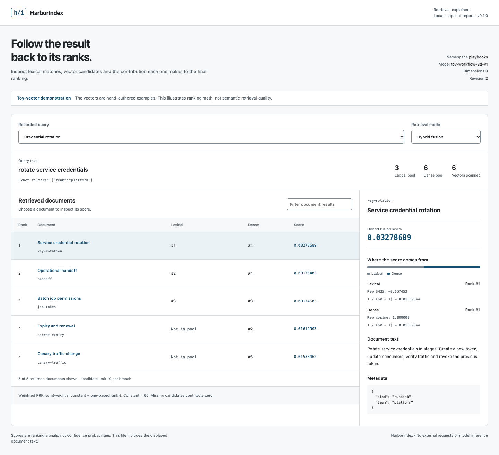

# HarborIndex

**Local hybrid retrieval you can inspect.** Combine keyword matches and your own embeddings in one SQLite file, then see exactly why each document ranked where it did.

[](https://github.com/ABRJrocks/harborindex/actions/workflows/checks.yml)
[](https://www.python.org/)
[](LICENSE)

[**Open the ranking inspector**](https://abrjrocks.github.io/harborindex/) · [Download v0.1.0](https://github.com/ABRJrocks/harborindex/releases/tag/v0.1.0) · [Integration guide](docs/integration.md) · [Retrieval contract](docs/retrieval.md)



## Put it in your workflow

A support tool, internal document assistant or local RAG prototype often already has embeddings. HarborIndex adds a keyword index, scoped cosine retrieval and transparent rank fusion without running another service. It returns document text, stable IDs, metadata, candidate ranks and each branch's contribution in the same response.

- **SQLite FTS5 BM25** for names, identifiers and exact words, with Unicode tokenization.
- **Exact cosine search** over supplied vectors, with matching model and dimension checks.
- **Weighted reciprocal rank fusion** with an explicit formula and score breakdown.
- **Namespace and metadata filtering before candidate limits**, in both search branches.
- **Atomic document replacement and deletion**, including full-text rows and vectors.
- **An offline HTML inspector** to compare lexical, dense and hybrid results for recorded queries.
- **Zero runtime dependencies**, no hosted service, model download or network calls.

Use it for small scoped corpora. Vector search is a Python exact scan, capped at 10,000 matching vectors per query. For large corpora, high concurrency or approximate indexing, use a dedicated search service. [Research and alternatives](docs/research.md) explains the choice.

## Install

Requires Python 3.10+ and SQLite compiled with FTS5 and JSON functions. Installation does not add SQLite extensions or an embedding model.

```sh
python -m pip install https://github.com/ABRJrocks/harborindex/releases/download/v0.1.0/harborindex-0.1.0-py3-none-any.whl
harborindex demo --output demo.html
```

Open `demo.html` in a browser. It contains three recorded query comparisons using **hand-authored toy vectors**. The demo verifies ranking arithmetic and filters, not semantic retrieval quality. The hosted inspector is the same static report: its controls select recorded results rather than executing new searches.

For a source checkout:

```sh
git clone https://github.com/ABRJrocks/harborindex.git
cd harborindex
python -m venv .venv
# Activate your environment using the command appropriate to your shell.
python -m pip install -e .
```

## Python API

```python
from harborindex import Document, Index

# Illustrative vectors only. Your embedding pipeline supplies real vectors.
with Index.create("guides.db", dimensions=3, model="my-encoder-v1") as index:
    index.upsert("team-guides", [
        Document(
            id="restore-01",
            title="Database restore",
            text="Restore a verified backup before reopening writes.",
            metadata={"team": "data"},
            vector=[1, 0, 0],
        ),
        Document(
            id="rotate-01",
            title="Token rotation",
            text="Rotate service tokens and revoke the previous credential.",
            metadata={"team": "platform"},
            vector=[0, 1, 0],
        ),
    ], model="my-encoder-v1")

    result = index.search(
        "team-guides",
        query="restore backup",
        vector=[1, 0, 0],
        model="my-encoder-v1",
        where={"team": "data"},
        k=5,
        candidate_limit=50,
    )
    for hit in result.hits:
        print(hit.id, hit.score, hit.components)
```

`Index.create` refuses to overwrite an existing file. Reopen with `Index.open("guides.db")`, or `read_only=True` for a reader. Use `mode="lexical"` with query text only, or `mode="dense"` with vector and model only. API search defaults to hybrid; CLI search defaults to lexical. Every index operation requires an explicit namespace.

## Command line

The example corpus contains public toy data. Each JSONL row is one document. Vector ingestion must name the same model label used at initialization.

```sh
harborindex init playbooks.db --dimensions 3 --model toy-workflow-3d-v1
harborindex upsert playbooks.db --namespace playbooks --input examples/documents.jsonl --model toy-workflow-3d-v1
harborindex search playbooks.db --namespace playbooks --mode hybrid --query "rotate credentials" --vector examples/vector.json --model toy-workflow-3d-v1 --where '{"team":"platform"}'
harborindex report playbooks.db --namespace playbooks --queries examples/queries.json --model toy-workflow-3d-v1 --output comparison.html
harborindex stats playbooks.db --namespace playbooks
harborindex delete playbooks.db --namespace playbooks key-rotation
```

Commands print JSON on success and return exit code 2 for validation or file/database errors. `python -m harborindex` provides the same commands. See `harborindex --help` and `harborindex search --help` for limits and weights. Reports refuse to overwrite existing files.

## Why a document wins

Hybrid results use one-based ranks:

```text
score(document) = lexical_weight / (rank_constant + lexical_rank)
                + dense_weight   / (rank_constant + dense_rank)
```

A missing candidate contributes zero. The default constant is 60, both weights are 1 and each branch keeps up to 50 candidates. Every returned hit includes raw branch scores, branch ranks and fusion contributions. Ties sort by document ID. Scores are ranking signals, not confidence probabilities. Tune with held-out relevance labels from your own workload.

## Operational boundaries

- One immutable embedding model label and dimension count per database. Labels catch accidental mixing, but do not prove vector provenance. Re-embed into a new database when changing models.
- Namespace and flat string filters scope queries. Your application remains responsible for authentication and deriving authorized scope.
- FTS5 BM25 corpus statistics are global across the database. Other namespaces can influence lexical scores even though their documents cannot enter a scoped candidate pool. Use separate files when ranking statistics must be isolated.
- SQLite files and report exports contain plaintext document data. Reports include full retrieved text, metadata and queries. Review them before sharing.
- One connection per thread, one SQLite writer at a time. This release supports SQLite's default DELETE journal mode; WAL databases are rejected.
- Report generation rejects an index that changes between its search snapshots. It is a diagnostic export, not a tamper-proof audit artifact.

## Verify and develop

```sh
python -m pip install -e . build ruff
python -m unittest discover -s tests -v
ruff check src tests examples
python examples/retrieval_adapter.py
python -m build
```

Browser checks run the actual generated report, test controls, hostile text escaping, mobile overflow and WCAG automated rules:

```sh
python tests/browser/prepare.py
cd tests/browser
npm ci
npx playwright install chromium
npm test
```

[Contributing](CONTRIBUTING.md) · [Security](SECURITY.md) · [Changelog](CHANGELOG.md)
